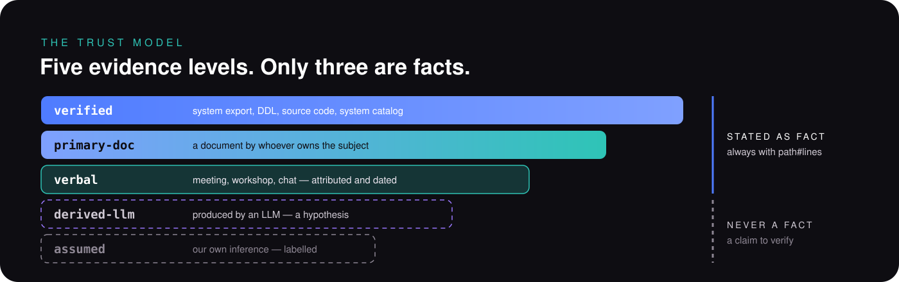

<p align="center">
  
</p>

# Project Second Brain

**A template that turns a pile of project documents into a knowledge base an AI agent can
reason over without losing fidelity or making things up. It works with Claude Code and
GitHub Copilot.**

Every project of any size piles up material: specifications, spreadsheets, meeting notes,
e-mails, diagrams, decks, earlier deliverables written with an LLM. Generic assistants
degrade on it:
- tables get chunked apart and large files get truncated;
- counts are guessed;
- nothing separates what a source *says* from what a previous model *inferred*.

This repository is the scaffolding of a **project second brain**:

- **Evidence-ranked.** Every note and every claim carries an evidence level, from
  `verified` to `assumed`. Answers cite `path#Lstart-Lend` or the SQL they ran.
  LLM-derived material is never stated as fact.
- **Deterministic where it can be.** Counting and joining happen in DuckDB, never by
  reading a table as text. Relations come from a knowledge graph built without an LLM.
- **Rules as code.** A schema, a lint and agent hooks enforce the contract: raw sources
  are immutable, extracted text is never rewritten, generated views are never hand-edited.
- **Agent-neutral.** One protocol (`AGENTS.md`), one set of slash commands
  (`.claude/skills/`) and one guard, shared by **Claude Code** and **GitHub Copilot**.
- **Git-native and local.** Markdown + YAML, reviewed in pull requests. Raw material and
  the Python environment stay in your project folder; originals are never committed.

It is agnostic to organisation, industry and subject matter. Everything project-specific
lives in configuration.

> Read [PREREQUISITES.md](PREREQUISITES.md) first, then **Start a new project** below.
> Design rationale: [ADR-0001](artifacts/adr/ADR-0001-second-brain-architecture.md),
> [ADR-0002](artifacts/adr/ADR-0002-kb-rules-as-code.md),
> [ADR-0003](artifacts/adr/ADR-0003-agent-neutral-operation.md) · Method:
> [docs/workflow.md](docs/workflow.md) · Agent protocol: [AGENTS.md](AGENTS.md) ·
> Slide deck: [docs/second-brain-approach.html](docs/second-brain-approach.html)
> (download it and open it in a browser).

---

## How it works

<p align="center">
  
</p>

| Layer | What lives there | Who writes it |
|---|---|---|
| `inbox/` | New material, not yet trusted | You |
| `source/` | The originals, exactly as received (+ `MANIFEST.md`) | Triage only; never edited |
| `knowledge/extracted/` | Markdown produced by the parsers | Parsers; only the frontmatter may change |
| `knowledge/curated/` | Data dictionary, Mermaid transcriptions of diagrams, summaries | You and the agent |
| `metadata/` | DuckDB: tabular assets and the brain's index | The tools (rebuildable) |
| `artifacts/` | Analysis (observed), design (intended), registers, ADRs | You and the agent, through commands |

<p align="center">
  
</p>

**Registers.** Three YAML files in `artifacts/registers/` are the project's memory.
Markdown views and DuckDB tables are generated from them.
- **Open points** (`OP-nnn`): questions the evidence cannot answer yet, each with an owner
  and an impact.
- **Claims** (`C-nnn`): every assertion about the current state that a design depends on,
  with its evidence. A coverage table shows how much rests on `assumed`.
- **Decisions** (`D-nnn`): what was decided and why.

**Knowledge graph.** `tools/kb/graph.py about <X>` answers "what do we know about X" in
one call: X's upstream and downstream objects, the register items that mention it, and
**the exact note sections (path and line range) to read**. The graph is built
deterministically from:
- the structured sources you declare in `tools/kb/graph_sources.yaml`;
- a concept dictionary (`tools/kb/entities.yaml`);
- exact identifier matches in every note.

---

## Start a new project

Each project gets its **own repository**, created from this template. Pick one way:

| Way | When | How |
|---|---|---|
| **A. Use this template** (recommended) | You use GitHub | On this repository's page: **Use this template → Create a new repository**, choose **Private**, then clone it. |
| **B. GitHub CLI** | Same, from the terminal | `gh repo create my-project-brain --template natalinio/project-second-brain --private --clone` |
| **C. Local copy, no GitHub** | Offline, or another Git host | Download the ZIP (**Code → Download ZIP**) and unzip it, or use the commands below, then push to your own remote if you want one. |
| D. Fork | Only to **contribute back** to the template | A fork of a public repository is public; never put project material in it. |

Option C, from a terminal:

```bash
# macOS / Linux / Git Bash
git clone --depth 1 https://github.com/natalinio/project-second-brain.git my-project-brain
cd my-project-brain && rm -rf .git && git init -b main
```

```powershell
# Windows PowerShell
git clone --depth 1 https://github.com/natalinio/project-second-brain.git my-project-brain
cd my-project-brain; Remove-Item -Recurse -Force .git; git init -b main
```

Then, in the project folder:

```bash
# 1. Create the environment in ./.venv (inside the project folder), install the git hook, first refresh
./scripts/setup.sh                 # macOS / Linux / Git Bash   (add: docs ole   to parse documents)
.\scripts\setup.ps1                # Windows PowerShell         (add: -Extras docs,ole)

# 2. Describe the project
#    edit project.yaml: name, one-line description, domains, owners

# 3. Open your agent in the folder and initialise
claude                             # Claude Code (terminal or VS Code extension) → /init-brain
code .                             # VS Code → Copilot Chat, Agent mode → /init-brain
```

To see a working example first, run `uv run python tools/kb/bootstrap.py --demo --no-hook`
in a **throwaway copy**. It loads a small fictional project, then
`uv run python tools/kb/graph.py about ORDERS_DAILY` shows the graph at work.

---

## Daily use

```text
drop files into inbox/  →  /ingest all  →  /review-note <note>  →  /ask <question>
                                      ↘  /capture op|claim|decision  ↗
```

| Command | Use it to |
|---|---|
| `/init-brain` | Set up once: project name, folders, registers, git hook, first index build |
| `/ingest <file\|all>` | Triage new material, parse it, refresh, and report what it confirms, contradicts or extends |
| `/ask <question>` | Get a grounded, cited answer (graph → SQL → line-range reads → text search) |
| `/capture <op\|claim\|decision> …` | Record or update a register item; views regenerate |
| `/impact <id\|object>` | See what depends on something before you change or contradict it |
| `/review-note <path>` | Check an extraction's fidelity, write its abstract, mark it `checked` |
| `/kb-status` | KB health in one table, plus the next three actions |

The tools also run by hand from the project folder:

```bash
uv run python tools/kb/refresh.py                       # registers → catalog/index → graph → lint
uv run python tools/kb/graph.py about <OBJECT>          # also: impact <id>, path <A> <B>, find <text>
uv run python tools/ingest/query.py --tables            # list tables (structured DB + kb.*)
uv run python tools/ingest/query.py "SELECT * FROM kb.reg_open_points WHERE status = 'open'"
uv run python tools/ingest/parse_docs.py --only <name>  # documents → knowledge/extracted/
```

## Using it with Claude Code or GitHub Copilot

Both agents share the same files. Nothing is duplicated, so a change applies to both.

| | Claude Code | GitHub Copilot (VS Code, agent mode) |
|---|---|---|
| Protocol | `CLAUDE.md` → imports `AGENTS.md` | `AGENTS.md` |
| Slash commands | `.claude/skills/*/SKILL.md` | same files (`.claude/skills/` is read by Copilot) |
| Guards before a write | `.claude/settings.json` → `tools/kb/hooks/pre_tool.py` | `.github/hooks/kb-guard.json` → same script |
| Lint after a write | `.claude/settings.json` → `tools/kb/hooks/post_tool.py` | `.github/hooks/kb-guard.json` → same script |
| Workspace settings | — | `.vscode/settings.json` (enables AGENTS.md and hooks, selects `.venv`) |
| Backstop for any tool | git pre-commit hook (lint + registers) | same |

In Copilot, use **Agent** mode, so it can run the `uv run …` commands in the terminal.

## What the guards block

| Attempt | Result |
|---|---|
| Write or delete anything in `source/` (except `MANIFEST.md`) | Blocked |
| Edit the body of a `knowledge/extracted/` note or of an accepted ADR | Blocked; frontmatter edits are allowed |
| Hand-edit a generated register view | Blocked; edit the YAML instead |
| `rm`, `Remove-Item`, redirections, moves out of protected folders (POSIX or Windows paths) | Blocked |
| Any write to `knowledge/`, `artifacts/`, `docs/` | Linted at once; errors go back to the agent |

## Repository map

```text
AGENTS.md             the operating protocol for every agent (CLAUDE.md imports it)
project.yaml          your project's name, domains, owners
.claude/skills/       slash commands shared by Claude Code and GitHub Copilot
.claude/settings.json Claude Code hooks          .github/hooks/   GitHub Copilot hooks
.vscode/              workspace settings for VS Code / Copilot
scripts/              setup.sh / setup.ps1: environment in ./.venv, git hook, first refresh
inbox/                drop zone (content gitignored; README explains the lanes)
source/               raw originals by lane (gitignored) + MANIFEST.md
knowledge/            extracted/ and curated/ notes + index.md (map of content)
metadata/             DuckDB databases and generated reports (rebuildable, gitignored)
artifacts/            analysis/, design/, registers/, adr/, _imported/
docs/                 method, parsing coverage, customising guide, templates, deck, images
examples/demo/        a tiny fictional project used by the tests
tools/ingest/         parsers, loaders, read-only SQL
tools/kb/             schema, lint, registers, catalog, graph, hooks, bootstrap
tests/                pytest suite (skeleton, demo, hooks for both agents)
```

## Customising

All project-specific behaviour is configuration: `project.yaml`, `tools/kb/schema.yaml`,
`tools/kb/graph_sources.yaml` and `tools/kb/entities.yaml`. Commands are plain skill files.
See [docs/customising.md](docs/customising.md).

## Confidentiality

- `source/`, `inbox/` and the generated databases are **gitignored**. Only the manifest,
  the notes and the deliverables are versioned.
- Extracted notes *do* contain the text of your documents, so a real project's repository
  must be **private**.
- The protocol forbids sending `source/` content to any external service other than the
  AI agent approved for the project.
- E-mail addresses are reduced to `Name (domain)` by the parser.
- The template has no telemetry, no external fonts and no network calls of its own. The
  only network access is optional: Docling's model download on first use.

## Limitations

- Retrieval is graph + SQL + text search, not embeddings. That is a deliberate choice for
  corpora of hundreds of notes (ADR-0001). A vector index waits for a measured need.
- Agent hook formats belong to their vendors and may change. The git pre-commit hook stays
  the backstop, and `tests/test_hooks.py` covers each known payload shape.
- Scanned documents need `--ocr` and a model download. Legacy binary Office formats are
  only partly supported; re-save them as OOXML.
- The graph is only as good as its declared sources and its entity aliases.

Contributions are welcome: see [CONTRIBUTING.md](CONTRIBUTING.md). Licence: [MIT](LICENSE).
